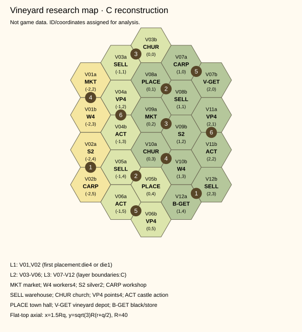

# 포도밭 확장 공개 자료 조사 및 복원 가능성

조사일: 2026-10-20(KST). **조사 전용: 게임 엔진·UI·에셋·규칙을 변경하지 않았으며 구현을 시작하지 않았다.** 공식 판정, 사진 판독, 논리적 복원 후보를 구분한다. 사용자 소장품/사진은 요청하지 않았다.

## 1. 결론과 확인 수준

- 개인 보드: 육각형 **24칸**, 고정된 이중 육각형 배치 공간 **12곳**, 주사위 표시 **12개**, 보너스 그림 **24개**를 식별했다. 번호와 보너스의 칸별 대응은 아래 표에 있다. 대부분 C(교차 복원)이며, 규칙서가 칸별 전체 표를 제공한 A 전수 검증과는 다르다.
- 보드는 3층으로 보이며 아래→위 2/4/6개 이중 공간으로 복원했다(C). 좌표는 조사자가 부여한 상대 좌표이며 인쇄물의 공식 칸 ID/실측 mm가 아니다.
- 타일51장은 전수 실물 목록을 확보하지 못했다. 공식 p.19의 한 장면에서9개, 별도 리뷰 사진에서9개의 앞면을 판독했다. 여러 사진의 같은 타일을 다시 셌을 수 있으므로 18/51장 전수 확인이라고 주장하지 않는다. 중복 조합을 제거하면 **14종의 서로 다른 조합**이 보인다.
- 다만 공식 제거 규칙의 수량을 사용하면 **혼합15종×3장+동색6종×1장=51장**을 논리적으로 도출할 수 있다. 아래 51장 목록은 **C 복원 후보**이며 사진으로51장 전수 확인한 공식 등록 데이터가 아니다. 현재 코드에는 추가하지 않았다.
- 보너스: 전체24장·6종, 준비·층 완성·종료 점수는 A. **품종별 정확한 수량은 D**, 4장씩이라고 임의 확정하지 않았다.
- 완전 공식 재현을 확정하기에는 공급대2·3인면의 눈금 대응과 보너스 품종별 수량 등 확인이 더 필요하다. 전체를 커스텀으로 바꿀 필요는 낮으며, 먼저 C 복원 근거 채택 여부를 결정하는 편이 합리적이다.

등급: **A** 공식 규칙 본문 직접 확인 / **B** 공식 구성품 도상 확인 / **C** 공식 도상·공개 사진 교차 또는 명시 수량의 논리적 복원 / **D** 부분 확인·판독/수량 미확정 / **E** 이번 조사에서 확인 불가. C는 출판사 인증을 뜻하지 않는다. 문서의 미확인은 자료가 세상에 없다는 뜻이 아니다.

## 2. 실제 조사 출처와 접근 결과

| ID | URL/자료 | 실제 확인 범위·제한 |
|---|---|---|
| S1 | [Awaken 공식 영문 PDF](https://awakenrealms.com/images/download/CoB/CoB_Rulebook_285x210mm%20%5B28%20pages%5D.pdf) | HTTP200 application/pdf, 19,620,991bytes. 웹 도구에서는 오류였으나 일반 공개 HTTP로 다운로드 성공. 인쇄3·7~9·19~21쪽 직접 읽기/렌더링 |
| S2 | [Awaken 다운로드](https://awakenrealms.com/download) | 공개 페이지 열림, 웹 텍스트 추출0줄. S1을 직접 확인 |
| S3 | [BGG 공식 규칙서 자료실](https://boardgamegeek.com/filepage/266287/special-edition-rulebook) | 웹 도구 내부 접근 오류. 이 페이지에서 별도 파일을 내려받았다고 주장하지 않음 |
| S4 | [사용자 제시 BoardGamesBot URL](https://www.boardgamesbot.com/assets/games-library/the-castles-of-burgundy-special-edition/manual_eng.pdf) | HTTP200이지만 실제 Content-Type text/html, PDF 아님. 규칙 텍스트는 공개 표시되나 독립 PDF 원본으로 취급 안 함 |
| S5 | [제작사 업데이트5](https://gamefound.com/en/projects/awaken-realms/castles-of-burgundy-special-edition/updates/5) | 포도밭 보드4개 공개 이미지 검색 결과 확인. 페이지 본문 추출0줄/직접 HTTP403; 원본 보드 이미지도403으로 상세 전사에 사용 안 함 |
| S6 | [제작사 업데이트6](https://gamefound.com/en/projects/awaken-realms/castles-of-burgundy-special-edition/updates/6) | 페이지 직접403. 공개 CDN의 아래 타일 이미지는 HTTP200,1600×885로 직접 확인. 초기 캠페인 렌더이므로 최종품 수량 증거로 쓰지 않음 |
| S7 | [제작사 업데이트7](https://gamefound.com/en/projects/awaken-realms/castles-of-burgundy-special-edition/updates/7) | 공개 검색에 구성51장/24보너스/공급대 설명. 초안(WIP) 규칙보다 최종 S1 우선 |
| S8 | [제작사 업데이트25](https://gamefound.com/en/projects/awaken-realms/castles-of-burgundy-special-edition/updates/25) | 아크릴 샘플 사진/생산 색상 변경 가능성 설명 확인. 직접 페이지403, 상세 판독 근거로 사용 안 함 |
| S9 | [Board Games Land 리뷰](https://boardgamesland.com/castles-of-burgundy-special-edition-review/) | 본문/원본 사진 직접 HTTP200. 빈 보드1600×1200에서24칸 판독, 공급대/진행 중/보너스 사진 대조 |
| S10 | [Pecktec 영상](https://www.youtube.com/watch?v=NoOJrPNeSMM) · [BGG 영상 등록](https://boardgamegeek.com/video/447353/the-castles-of-burgundy-special-edition/learn-to-play-the-vineyard-expansion) | 제목/제작자/2023-07-19/챕터(00:43설명,07:30종료점수,08:39리뷰) 확인. 영상 본편·프레임·전체 자막은 접근 오류로 미검증. 시청했다고 주장하지 않음 |
| S11 | [팬 요약 PDF](https://playheavenlygames.com/wp-content/uploads/2023/07/lens-summary-v1-vineyard-expansion-castles-of-burgundy-se.pdf) | 검색 텍스트만 참고. 층 보너스를 다른 색으로 받으라는 문구는 S1 p.21의 동일 품종 복수 점수 예와 충돌하므로 채택하지 않음 |

저장소 `reference/official-rulebook-public.pdf`와 S1 다운로드 SHA256은 모두 `8e5822756333b3efee52a0c0e203d1a16b16a458e0b130a074d360d72c0c038f`. 기존 복사본도19~21쪽 추출 텍스트가 일치했다. 인쇄 페이지19~21은 PDF19~21페이지와 같다. PDF/사진 사본은 Git 제외 `.local-data/vineyards/`에만 저장했다. 접근 제한 우회·로그인·유료 자료 구매 없음.

### 참고 이미지 목록

- S6 공식 타일 그림: https://imgcdn.gamefound.com/richtextimage/richtext/e1609fec-1de2-4b72-a9c1-e16f1527181b.jpg
- S5 보드 렌더 URL(403, 상세 미확인): https://imgcdn.gamefound.com/richtextimage/richtext/a429b473-859a-404a-929f-a42cf126e6cb.jpg
- S9 빈 보드: https://boardgamesland.com/wp-content/uploads/2024/07/IMG_7329-scaled.jpeg
- S9 공급대: https://boardgamesland.com/wp-content/uploads/2024/07/IMG_7173-scaled.jpeg
- S9 진행 중: https://boardgamesland.com/wp-content/uploads/2024/07/IMG_7317-scaled.jpeg
- S9 검은 포도 보너스: https://boardgamesland.com/wp-content/uploads/2024/07/IMG_7182-scaled.jpeg
- 공식 도상: S1 p.3(전체 보드·타일·보너스), p.19(공급대/상점), p.20(배치 예), p.21(연결 점수 예).

사진 원본을 게임 이미지로 복사하거나 저장소에 재배포하지 않았다. 아래 SVG는 사진 픽셀을 사용하지 않는 자체 조사 도식이다.

## 3. 공식 규칙 요약 — A

### 준비와 단계별 공급 (p.19)

구성: 보드4개, 이중 타일51장, 포도 보너스24장/6종, 공급대1개, 상점1개, 주머니1개(p.3).

6종 보너스에서 한 세트(각1개)를 먼저 떼어 각 플레이어에게 무작위로1개씩 지급한다. 그 세트의 남은 것은 공용 보너스 풀로 돌린다. 따라서 시작 보너스는 플레이어끼리 서로 다른 종류다. 전체 풀을 섞어 중복 종류가 나올 수 있게 나누는 방식이 아니다.

| 인원 | 매 단계 공급대 | 매 단계 상점 | 5단계 공급 수 합계 |
|---|---:|---:|---:|
| 2 | 3 | 1 | 20 |
| 3 | 3 | 3 | 30 |
| 4 | 6 | 3 | 45 |

각 단계 시작 시 남아 있는 공급대/상점 타일은 상자에 제거하고 주머니에서 무작위 보충한다. 남은 것을 주머니로 되돌리거나 다음 단계로 이월하지 않는다. 3인 표시 상점 칸은3인일 때만 보충한다. 2·3인면 공급대 한 타일 아래에는 가능한 눈금2개가 인쇄되어 둘 중 하나로 획득한다. **정확한 세 쌍 번호는 E**: 본문에 없고 확보한 사진은4인면이므로 (1,4) 등으로 추정하지 않는다.

선택 규칙:3인은 선택한 품종1개를 포함한 타일16장과 그 보너스를 제거한다.2인은 선택한 품종2개를 포함한 타일29장과 그 보너스를 제거한다. 남은 타일은35/22장이다. 품종 축소는 기본 필수 규칙이 아니다.

### 획득·보관·배치 (p.20)

- 주사위1개로 눈금이 맞는 공급대 타일1개 획득. 보관함의 열쇠칸 **2개**를 차지한다. 부족하면 기존 일반 타일(들) 또는 이중 타일을 폐기하여 공간을 만든다. 배치된 영지 타일을 철거하는 뜻으로 해석하지 않는다.
- 별도 주사위1개로 눈금이 맞는 **비어 있는 인쇄 이중 공간**에 보관 타일을 배치한다. 개인 영지에는 배치하지 않는다. 첫 배치는 최하층의1/4 공간만 가능. 이후는 기존 포도 타일과 최소 한 변 인접해야 한다.
- 배치 전 회전 가능, 배치 후 이동·회전 불가. 회전은 해당 인쇄 이중 공간의 두 칸을 정확히 덮어야 한다. 일반 육각형2칸 아무 곳에 놓는 자유 폴리오미노 규칙으로 바꾸면 안 된다. 각 공간에서 두 품종의 순서를 뒤집는 선택을 표현할 수 있어야 한다.
- 덮은 두 칸의 보너스를 원하는 순서로 처리한다. 두 보너스와 그 후속 선택을 해결한 뒤 해당 층 완성을 확인한다. 한 층 완성 시 풀에서 보너스1개를 선택한다. 단계10/8/6/4/2점이나 일반 영지 구역 점수를 포도밭 층에 임의 추가하지 않는다.
- 기존 건물·성 효과와 같은 보너스를 사용한다. 새 보너스는 (a) 검은 공급처 일반 타일 또는 포도 상점 이중 타일 무료 획득(유료 구매 제한 소모 안 함), (b) 포도 공급대의 이중 타일 무료 획득(상점 제외)이다. 이중 타일은 무료라도 보관2칸이 필요하다.
- 포도 상점은 은화2 구매를 검은 공급처 구매 대신 사용한다. 턴당1회·타일1개를 공유하고 검은 공급처 적용 효과도 상점에 적용한다. 기존 프로젝트 여관도 검은 구매와 제한을 공유하므로 추후 공통 purchase flag를 재사용할 수 있다. 무료 검은 획득에 여관까지 포함되는지는 p.20에서 직접 명시하지 않아 별도 확인 대상으로 둔다.
- 일꾼의 일반 순환 보정은 기본 규칙(p.11)을 재사용할 근거가 있다. 수도원9~12 등의 '타일' 보정이 포도 획득/배치에 각각 적용되는 세부 범위는 p.19~21만으로 전부 확정하지 않는다.

### 종료 점수 (p.21)

같은 품종끼리 변을 공유한 육각형들의 연결 영역을 센다. 이중 타일 단위가 아닌 **포도 그림 한 칸**이 크기1이다. 모서리 접촉을 연결로 세지 않는다. 보너스 토큰 하나는 같은 품종 연결 영역 하나에만 사용하고, 영역도 한 번만 점수화한다. 같은 품종 토큰 여러 개를 한 큰 영역에 곱하지 않는다. 서로 다른 같은 품종 영역에 각각 쓸 수 있다. 최대 점수를 자동 계산한다면 품종별 영역을 크기순 정렬해 보유 토큰 수만큼 채점하는 방식과 동일하다(알고리즘적 설명).

| 크기 | 1 | 2 | 3 | 4 | 5 | 6 | 7 | 8 | 9 | 10 | 11 | 12 | 13 |
|---|---:|---:|---:|---:|---:|---:|---:|---:|---:|---:|---:|---:|---:|
| VP | 1 | 3 | 6 | 10 | 15 | 21 | 28 | 36 | 45 | 55 | 66 | 78 | 91 |

공식 예: 녹색 토큰2개로 녹색 영역3칸/1칸을 각각6/1점, 파란 토큰1개로2칸을3점, 총10점. 숫자는 규칙 사실을 재서술한 것이며 원문 문장을 복제하지 않았다. 표는13까지만 인쇄되어 있다. 임의로14이상 범위를 공식 표라고 추가하지 않는다.

## 4. 개인 포도밭 보드 복원

**24/24 육각형의 위치·보너스 도상,12/12 주사위 숫자 대응을 복원(C).** 첫 배치1/4와 V01의4일꾼·시장 조합은 A(공식 p.20 예). 슬롯의 그 외 세부 대응은 S1 p.3/p.20/p.21과 S9 빈 보드 사진을 대조했다. 확대해도 불명확한 도상을 새 효과로 만들어 넣지 않았다. 모든 복원 수치를 공식 데이터 파일로 등록한 것은 아니다.

도식의 방향: 농가가 위, 황색 최하층이 왼쪽. flat-top axial(q,r), 원점은 맨 위 교회 칸. 상대 중심은 `x=1.5Rq`, `y=√3 R(r+q/2)`. R과 원점 이동은 도식 작성용일 뿐 실물 크기 측정값이 아니다. 외곽 q열 길이는4/5/6/5/4. 인접 변은 axial차이 (±1,0),(0,±1),(1,-1),(-1,1)로 판정한다. 슬롯 ID V01~V12 및 a/b는 조사 ID다. a/b 순서는 포도 타일의 고정 품종 방향이 아니다.

| 공간/층(C) | 주사위/등급 | a 칸 좌표·보너스 | b 칸 좌표·보너스 | 도상 대응 등급 |
|---|---|---|---|---|
| V01 / L1 | 4 / A | V01a (-2,2) · 시장(선박/가축 획득) | V01b (-2,3) · 일꾼4 | A(공식 예) |
| V02 / L1 | 1 / A | V02a (-2,4) · 은화2 | V02b (-2,5) · 목공소(건물 획득) | C |
| V03 / L2 | 3 / C | V03a (-1,1) · 창고(상품 종류 판매) | V03b (0,0) · 교회(성/광산/수도원 획득) | C |
| V04 / L2 | 6 / C | V04a (-1,2) · 승점4 | V04b (-1,3) · 일반 성 자유 추가 행동 | C |
| V05 / L2 | 2 / C | V05a (-1,4) · 창고(상품 종류 판매) | V05b (0,4) · 시청(보관 타일 무료 배치) | C |
| V06 / L2 | 5 / C | V06a (-1,5) · 일반 성 자유 추가 행동 | V06b (0,5) · 승점4 | C |
| V07 / L3 | 5 / C | V07a (1,0) · 목공소(건물 획득) | V07b (2,0) · 포도 공급대 무료 획득 | C |
| V08 / L3 | 2 / C | V08a (0,1) · 시청(보관 타일 무료 배치) | V08b (1,1) · 창고(상품 종류 판매) | C |
| V09 / L3 | 3 / C | V09a (0,2) · 시장(선박/가축 획득) | V09b (1,2) · 은화2 | C |
| V10 / L3 | 4 / C | V10a (0,3) · 교회(성/광산/수도원 획득) | V10b (1,3) · 일꾼4 | C |
| V11 / L3 | 6 / C | V11a (2,1) · 승점4 | V11b (2,2) · 일반 성 자유 추가 행동 | C |
| V12 / L3 | 1 / C | V12a (1,4) · 검은 공급처/포도 상점 무료 획득 | V12b (2,3) · 창고(상품 종류 판매) | C |

층 구성 후보(C): L1=V01/V02(4칸), L2=V03~V06(8칸), L3=V07~V12(12칸). 번호별2회 인쇄라는 산술 교차 검사도 맞는다. 층은 밝기와 영역 경계에서 읽었으며, 인쇄 본문이 2/4/6 목록을 직접 명시한 것은 아니다. 이 C경계를 구현 기준으로 채택할지는 승인 대상이다.

보드4개는 공식 p.3에서 동일 도상을 반복한 것으로 보인다(B/C). 4개의 모든 실물 뒷면/판본 차이 전수 검사는 E. 보드 전체를 돌려 다른 시작층을 선택한다는 규칙은 확인되지 않았다. 보드 회전으로 첫 배치 제한을 우회하게 만들면 안 된다.

## 5. 포도51장 분석

품종은 실물 사진에서 **파랑(B), 검정(K), 녹색/연두(G), 주황(O), 빨강/자홍(R), 노랑(Y)** 6종이다(B:공식 p.3/p.19 및 S6). 실제 와인 품종명은 표기되어 있지 않아 Chardonnay/Pinot 등으로 명명하지 않는다. 기존 상품6색 번호와 같은 매핑이라는 근거도 없으므로 상품 색상과 포도 품종을 별도 enum으로 둘 필요가 있다.

### 사진에서 직접 읽은 예

공식 p.19 공급대 왼쪽→오른쪽: B-K, O-B, Y-Y, Y-O, G-R, R-O. 상점 왼쪽→오른쪽: K-O, B-G, O-Y. **한 장면9개/서로 다른8조합(B)**. 리뷰 S9 공급대의6개는 B-B, O-G, B-G, G-B, K-G, K-Y, 상점의 맨 위3개는 O-Y, B-G, B-Y로 판독했다(D, 공식 도상과 교차시 C). 동일 B-G가 여러 개 보이며 사진 속 더미의 가려진 면은 세지 않았다. S6의 R-Y 조합도 보인다(B, 초기 렌더). 합쳐서14종 존재 확인이며, 유일 실물 ID가 없어 사진 사이 타일 동일성/복제 수량은 전수 식별하지 못했다.

### 제거 수량으로 도출한 51장 후보 — C, 공식 전수 사진 아님

A 근거(p.19): 아무 한 품종을 제거하면16장, 아무 두 품종을 제거하면29장, 전체51장. 품종a를 포함하는 타일 집합을 T(a)라 하면 서로 다른 a,b의 교집합은 `16+16−29=3`. 타일 하나는 포도 두 칸이므로 이 교집합은 정확히 a-b 혼합 타일이다. 각 혼합 조합은3장. 한 품종의 다른5색 혼합은15장이므로 남은 동색 타일은 `16−5×3=1`장. 전체 `15×3+6=51`, 실제 포도 칸은102개로 품종별17칸이다. 품종별 '타일 포함16장'과 '포도 그림17칸'은 다른 수치다.

이는 임의 균등 분배 가정이 아니라 **본문 수량이 모든 선택 품종에 동일하게 적용된다는 해석하의 포함배제 결과**다. 여러 공개 사진의 동색 Y-Y/B-B 및 혼합 중복과도 모순되지 않는다. 오탈자/판본 차이 가능성까지 배제한 공식 전수 검증은 아니므로 C로 유지한다. 아래 연구용 R01~R51은 공식 인쇄 ID가 아니며 게임에 등록하지 않는다.

| 조합 | 연구용51장 대응 ID | 수량 후보 | 조합 존재 사진 | 수량 등급 |
|---|---|---:|---|---|
| B-B | R01 | 1 | S9 사진 | C |
| B-K | R02, R03, R04 | 3 | 공식 p.19 | C |
| B-G | R05, R06, R07 | 3 | 공식 p.19/S9 | C |
| B-O | R08, R09, R10 | 3 | 공식 p.19 | C |
| B-R | R11, R12, R13 | 3 | 미관찰(E); 논리 복원 후보만 있음 | C |
| B-Y | R14, R15, R16 | 3 | S9 사진 | C |
| K-K | R17 | 1 | 미관찰(E); 논리 복원 후보만 있음 | C |
| K-G | R18, R19, R20 | 3 | S9 사진 | C |
| K-O | R21, R22, R23 | 3 | 공식 p.19/S6 | C |
| K-R | R24, R25, R26 | 3 | 미관찰(E); 논리 복원 후보만 있음 | C |
| K-Y | R27, R28, R29 | 3 | S9 사진 | C |
| G-G | R30 | 1 | 미관찰(E); 논리 복원 후보만 있음 | C |
| G-O | R31, R32, R33 | 3 | S9 사진/S6 | C |
| G-R | R34, R35, R36 | 3 | 공식 p.19/p.20 | C |
| G-Y | R37, R38, R39 | 3 | 미관찰(E); 논리 복원 후보만 있음 | C |
| O-O | R40 | 1 | 미관찰(E); 논리 복원 후보만 있음 | C |
| O-R | R41, R42, R43 | 3 | 공식 p.19 | C |
| O-Y | R44, R45, R46 | 3 | 공식 p.19 | C |
| R-R | R47 | 1 | 미관찰(E); 논리 복원 후보만 있음 | C |
| R-Y | R48, R49, R50 | 3 | S6 | C |
| Y-Y | R51 | 1 | 공식 p.19 | C |

확인 불가(E): 실물51장의 개별 인쇄/제조 ID, 전수 앞면 사진, 판본별 인쇄 차이. 수량 C후보를 확정 공식 데이터로 표시하려면 추가 공개 전수 자료 또는 이 근거를 채택한다는 프로젝트 결정이 필요하다. 사용자에게 사진을 요청하는 단계는 두지 않는다.

## 6. 포도 보너스24장

| 정보 | 결과 | 등급 |
|---|---|---|
| 전체 구성 | 24장,6종 | A(p.3) |
| 품종별 그림 | 파랑/검정/녹색/주황/빨강/노랑 포도, 불규칙 타원형, 물음표 점수 문양 | B(p.3), S9 검정 사진 |
| 품종별 수량 | 4장씩일 가능성은 있으나 본문 직접 명시와 전수 사진을 확보 못함. 미확정 | D |
| 시작 지급 | 6종 각1세트에서 인원수만큼 무작위1개씩, 남은 세트는 풀 복귀 | A(p.19) |
| 층 완성 | 두 보너스 해결 후 그 층 완성 확인, 풀에서1개 선택 | A(p.20) |
| 동일 품종 복수 | 허용. 각 토큰은 서로 다른 같은 품종 연결 영역에1회씩 사용 | A(p.21 예) |
| 보유하지 않은 품종 | 그 품종 영역만으로는 이 확장 종료 점수 없음 | A(p.21의 토큰 기준) |
| 보너스 풀 고갈/특수 조합 | 이번 본문에서 상세 예외 미확인. 수량/층 관계 검증 전 임의 대체 금지 | D |

단순히24÷6=4로 공식 수량이라고 확정하지 않았다. S1 p.3의 겹쳐 쌓인 그림만으로 가려진 토큰 수를 정확히 세지는 않았다. 팬 요약의 '이미 가진 종류와 다른 색을 골라야 한다'는 제한은 채택하지 않는다.

## 7. 기존 코드와 호환성 — 읽기 전용 분석

| 기능/관련 파일 | 재사용 가능 부분 | 필요한 별도 설계·위험 |
|---|---|---|
| types.ts / core/engine.ts / direct-actions.ts / core/modifiers.ts | GameAction검증, 주사위 소모/순환 일꾼 비용, 선택 취소 무소비 | vineyards는 ExtensionId 문자열만 존재. 실제 허용 확장 목록에 없고 intent/타일 타입도 미구현. 획득/배치 intent·포도 좌표/방향을 별도 추가해야 함 |
| PlayerState.storage / core/intents.ts의 tileDestination / save.ts |3열쇠 보관함·교체 확인 UX | 현재 타일1개=인덱스1칸 가정. 포도1개=2칸 점유/연결관계·동시 여러 타일 폐기·고유 소유권 검증이 필요. 같은 ID를2번 넣으면 기존 단일 소유권 검사를 깰 수 있어 그대로 적용 불가 |
| core/effects.ts | immediateOptions/resolveTileChoice,8건물/일반 성·흰 성 선택·합법 효과 | 현재 pendingEffects.length===1 검증, 효과 해결 시 pendingChoice와 effects를 모두 비움. 포도2보너스를 그냥 이어 넣으면 두 번째 유실 위험. 순서 선택+자식 연쇄 완료 후 남은 부모 보너스로 복귀하는 저장 가능한 스택/continuation 필요 |
| 흰 성 / core/effects.ts | 흰 주사위 값·일꾼 비용·연쇄 소비 보호 | 포도 보드 ACT 그림은 일반 성의 자유 추가 행동(p.7)이며 흰 성으로 바꾸면 안 됨. 흰 성 추가 행동이 새로운 포도 획득/배치도 지원하는지 범위 검증 필요 |
| inns.ts / core/engine.ts / TurnState.blackPurchaseUsed | 검은 타일/여관 은화2·턴당1회 공통 플래그 | 포도 상점 유료 구매도 동일 플래그. 포도 무료 검은 획득은 소모 안 함. 방패·수도원 검은 효과와 저장/서버 옵션 목록도 함께 감사 필요. 이번 여관 코드는 변경 안 함 |
| custom-trade-routes.ts / core/trade-effects.ts / core/engine.ts | 직접 use-die 판매만 진행하는 현재 경계 | 포도 창고/일반 성 추가 행동의 resolve-choice 판매를 직접 판매로 바꾸지 않으면 커스텀 무역로 연쇄 차단 유지 가능. 출처 메타데이터/재전송 ID 분리 필요 |
| core/phases.ts / practice.ts | 기존 단계A–E/RNG | 포도 별도 주머니/공급대/상점/제거풀, 선택 품종 축소, 중복 보충 방지 필요. 여관은 이월, 포도는 제거이므로 같은 보충 정책을 공유하면 안 됨 |
| computer.ts | 합법 행동 열거→가치 평가·기존 보상 선택 | 새 이중 점유/2방향/연결 영역·층 보너스·점수 토큰 희소성 평가가 필요. 단순 재사용만으로 플레이 가능하다고 볼 수 없음 |
| server/rooms.ts / room-http.ts | 서버 RNG·인증 좌석·revision·원자적 액션·재접속 | 서버 보유51장/카드 위치/두칸 소유권/방향/부모보너스 실행 ID를 검증. 클라이언트가 포도 종류나 보너스를 제출해 확정하지 않게 함 |
| save.ts / core/state.ts | 엄격한 파서/스키마/구버전 유지 | 확장 없는 과거 저장은 그대로, 새 확장은 옵션 활성 시만 추가. 점유쌍·품종보너스풀·층 보상 지급 여부·다중 pending 연쇄·종료 ledger 일관성 필요 |
| app/trade-route-panel.tsx / board-viewport.tsx | 접기·펼치기 공통 패턴/확대 이동 기반 | 개인 영지와 독립 포도 보드 패널이 적합. 현재 영지 칸/타일 그림/공용 좌표 변경 불필요. 모바일 회전 선택·2칸 점유 UX는 별도 QA |

기존 일반/흰 성/여관/방패/무역로/온라인 코드는 이번에 읽기만 했다. 현재 엔진의 한 pending 효과 제한 때문에 **보너스 종류보다 두 보너스의 순서·자식 효과 보존이 가장 큰 기술적 위험**이다. 일반 AI와 공식 Châteauma는 별개이며 후자는 이번 조사/향후 일반 AI 지원 범위로 몰래 포함하지 않는다.

## 8. 난이도와 권장 구현 순서 (승인 전 실행하지 않음)

1. 데이터 승인/보강: 보드 C좌표·층/51장 C수량을 채택할지 결정, 보너스 수량·2/3인 공급대 눈금 해결. 난이도 중.
2. 포도 별도 상태와 이중 저장 점유·서버/파서 무결성. 난이도 높음.
3. 획득/회전/배치/인접·2보너스 continuation·층 보너스·연결 종료점수. 난이도 높음(연쇄/중복 방지가 핵심).
4. UI 접기/회전 프리뷰·주사위 직접 조작, AI가 연결/토큰을 평가, 온라인 공개 상태와 재접속. 난이도 높음.
5. 2/3/4인25라운드·보상 순서/무료획득/검은 구매/무역로·방패/흰 성·저장 중단복원·서버 재전송 회귀. 난이도 높음.

코딩 시간이나 완료 일자는 현재 데이터 승인 없이 확정하지 않는다. 관련 타입/단위 검사 추가가 필요하다는 분석이며 이번에 테스트 코드를 쓰거나 전체 테스트/서버를 실행하지 않았다.

## 9. 공식 재현과 커스텀 대안

| 방안 | 장점 | 단점/난이도 | 이번 결론 |
|---|---|---|---|
| 공식 완전 재현 | 실물과 동일한 플레이·규칙 출처 명확 | 수량/공급 눈금과 C항목 추가 검증 전에는 '완전 동일' 확정 불가, 높음 | 현재 완료 판정 불가. 공개 자료 보강은 가능 |
| A: 공식 규칙 유지+미확인 항목만 프로젝트 설계 | 확인된24칸/12공간과 기본 흐름 대부분 유지, 차이가 작음 | 미확인 수량/눈금은 명시적 프로젝트 규칙/데이터로 구분, 높음 | C근거 채택으로 해결되는 항목을 먼저 구분한 뒤 최소 범위에만 검토 |
| B: 커스텀 포도밭 전체 설계 | 데이터 접근 문제 없이 원하는 구성/난이도 조정 | 밸런스 새 검증, 공식 보드/51장 재현 목표와 멀어짐; 엔진 난이도는 여전히 높음 | 이번 조사만으로 전체 커스텀 전환 필요성 낮음 |

C의 수학적 복원을 채택하는 것은 임의 조합을 창작하는 것과 다르지만, 공식 전수 검증 완료라고 표시할 수는 없다. 수량 D를 임의 균등화하거나 미확인 눈금을 숨겨 넣는 것은 승인 없이 하지 않는다.

## 10. 남은 확인과 사용자 결정 항목

- **E:**2·3인면 공급대의 정확한 눈금 세 쌍. 공개 뒷면 사진/판본 규칙 추가 확인 필요. 전면4인 번호를 임의 결합하지 않는다.
- **D:**포도 보너스6종의 각 수량(총24는A). 4장씩으로 구현하는 결정은 아직 내려지지 않았다.
- **C:**보드24칸/12공간 및 층2/4/6 대응, 51장 수량 논리 복원 후보. 정밀 실물 사진 전수 확인과 구분해 채택할지 결정.
- **D:**일부 수도원/방패의 포도 action 적용 범위, 무료 검은 획득에 여관 포함 여부, 후속 효과와 층 완성 보상 순서의 특수 조합. 기본 본문으로 명확한 부분을 넘어 임의 판정하지 않음.
- 선택할 방향: (1) 공개 자료 보강을 더 진행하며 공식 전수 확정을 기다림, (2) C근거는 프로젝트에서 채택하고 D/E만 최소 커스텀으로 별도 승인, (3) 전체 커스텀 보드/덱 설계. 추천은 **(2)를 검토하되 D/E의 값을 먼저 제안·승인받는 것**이며 이 문서는 값을 확정하지 않는다.
- 다음 요청에서 승인받아야 하는 것은 구현 착수 여부와 데이터 신뢰 기준/미확인 항목 처리 방향이다. 사용자에게 소장품·사진을 요구하지 않는다.

## 검사·작업 경계

원본 PDF SHA/복사본19~21쪽 일치, 도식24좌표 중복0·12쌍 인접, 후보51장 합/포도102개/각17/품종제거16/29의 산술 일관성을 조사용으로 검사했다. 이는 게임 기능 테스트가 아니다. 게임 엔진·UI·원본 PNG·기존 미커밋 내용은 변경하지 않았다. 원문 사진/규칙서 전체를 저장소에 올리지 않고 본 연구 문서·자체 SVG·연구 체크포인트만 별도 백업한다. **연구 결과 보고 후 중단하고 추가 승인 전 구현하지 않는다.**
